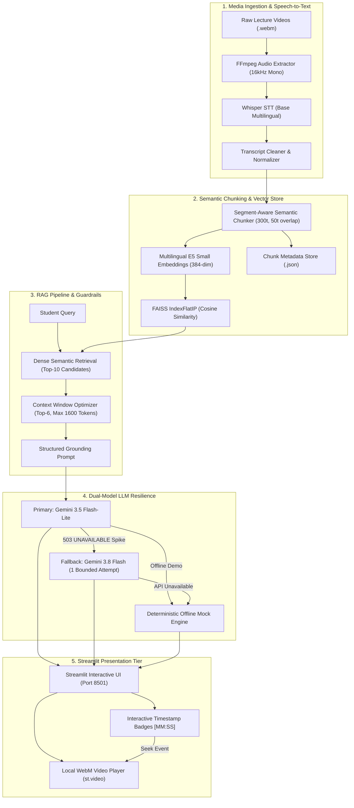
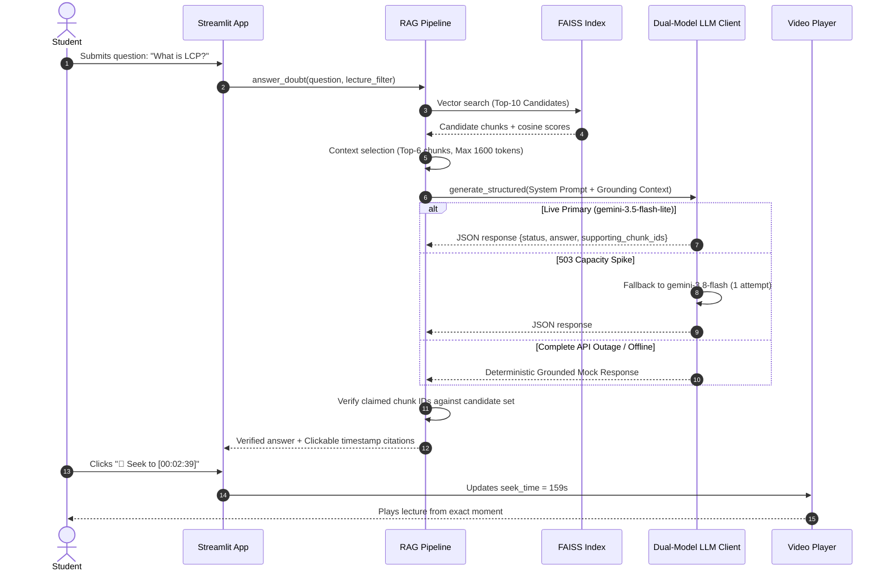

# LearnMate AI — Technical Architecture & Engineering Design
**PhysicsWallah APM Builder Screening Project**  
*System Architecture, Data Pipelines, RAG Mechanics, and Resilience Engineering*

---

## 1. High-Level System Architecture

LearnMate AI follows a modular, micro-pipeline architecture organized into five core functional tiers: Ingestion, Indexing, Retrieval-Augmented Generation (RAG), Application Core, and Presentation.

---

## 2. Ingestion & Preprocessing Subsystem

### 2.1 Audio Extraction (`video_processor.py`)
- **Engine:** FFmpeg 9.1 CLI wrapper.
- **Specification:** Extracts raw video tracks to 16 kHz single-channel (mono) PCM WAV (`-ar 16000 -ac 1 -c:a pcm_s16le`).
- **Rationale:** 16 kHz mono matches OpenAI Whisper's acoustic input expectations, minimizing resampling overhead and memory footprint.

### 2.2 Speech-to-Text Transcription (`transcriber.py`)
- **Model:** OpenAI Whisper `base` (multilingual model, 74M parameters).
- **Execution:** CPU inference via PyTorch (`torch.float32`), ensuring compatibility across environments without dedicated CUDA hardware.
- **Output:** Timestamped segments with start time, end time, speech tokens, and language detection (`hi`, `en`).

### 2.3 Transcript Cleaning & Anomaly Detection (`transcript_cleaner.py`)
- **Whitespace & Unicode:** Collapses duplicate spacing and strips zero-width non-breaking spaces.
- **Syntax Preservation:** Strictly retains technical syntax (`<h1>`, ``, `<!DOCTYPE html>`, `LCP`, `CLS`).
- **Repetition Suppression:** Identifies and cleans acoustic looping artifacts from background music or microphone latency.

---

## 3. Semantic Chunking & Indexing Subsystem

### 3.1 Segment-Aware Semantic Chunker (`chunker.py`)
Traditional fixed-character chunking disrupts sentence clauses and loses temporal context. LearnMate AI uses a **segment-aware sliding chunker**:
- **Target Size:** 300 BPE tokens.
- **Hard Maximum:** 400 BPE tokens.
- **Overlap:** 50 tokens (preserves context continuity across chunk boundaries).
- **Silence Gap Boundary:** Any silence gap $\ge 15.0$ seconds terminates chunk accumulation to isolate slide or topic transitions.
- **Temporal Traceability:** Calculates exact `start_time`, `end_time`, `start_timestamp` (`HH:MM:SS`), and `end_timestamp`.

### 3.2 Dense Multilingual Embeddings (`embeddings.py`)
- **Model:** `intfloat/multilingual-e5-small` via `sentence-transformers`.
- **Dimensions:** 384 dimensions.
- **Prefix Architecture:**
  - Queries: Prefixed with `"query: "`.
  - Passages: Prefixed with `"passage: "`.
- **L2 Normalization:** All vectors are $L_2$-normalized to unit length ($\|\mathbf{v}\|_2 = 1.0$), enabling inner product (`IP`) to compute exact cosine similarity:
  $$\text{sim}(\mathbf{q}, \mathbf{d}) = \mathbf{q} \cdot \mathbf{d}$$

### 3.3 Vector Database (`vector_store.py`)
- **Index:** `faiss.IndexFlatIP` (exact brute-force inner product without quantization loss).
- **Fallback Architecture:** Includes an embedded NumPy vectorized matrix multiplier (`np.dot`) that activates transparently if the native FAISS C++ library is unavailable.

---

## 4. RAG Pipeline & Evidence Verification (`rag_pipeline.py`)

### 4.1 End-to-End Query Execution Flow

### 4.2 Hallucination Defense & Answerability Classifier
The system prompt enforces strict trichotomous classification:
1. `ANSWERABLE`: Lecture context contains direct factual evidence. Citations are verified.
2. `PARTIALLY_ANSWERABLE`: Lecture covers some aspects; missing components are explicitly disclosed.
3. `NOT_ANSWERABLE`: Out-of-curriculum questions (e.g. quantum mechanics, cooking). The model refuses politely without guessing.

---

## 5. Dual-Model LLM Resilience & Zero-Cost Guardrails (`llm.py`)

### 5.1 Free-Tier Dual-Model Architecture
To address high-demand capacity spikes (`503 UNAVAILABLE`) on Google Gemini Free Tier without incurring API expenses:
- **Primary Model:** `gemini-3.5-flash-lite` (low latency, 15 RPM free tier).
- **Alternative Fallback Model:** `gemini-3.8-flash` (1M context, 65K max output, official free-tier eligible).
- **Single Bounded Fallback:** Exactly 1 fallback attempt is permitted upon receiving an HTTP 503. If the alternative model also encounters capacity constraints, the system immediately presents a student-friendly banner and offers a one-click switch to the deterministic Offline Demonstration mode.
- **Budget Lock:** Hardcoded to **₹0.00 / $0.00** total expenditure. Never calls paid billing endpoints.

---

## 6. Smart Notes & Practice Quiz Subsystems

### 6.1 Lecture Summarizer (`summarizer.py`)
- Synthesizes transcripts into 3 customizable formats: `Detailed Study`, `Quick Revision`, and `Key Concepts`.
- Multilingual output: English, Hindi, and Hinglish.
- Generates markdown files downloadable directly via `st.download_button`.
- Includes deterministic MD5-based file caching in `data/notes/`.

### 6.2 Practice Quiz Generator (`quiz_generator.py`)
- Generates multiple-choice questions (5 or 10 Qs) across `Easy`, `Medium`, and `Hard` tiers.
- Enforces strict schema constraints: exactly 4 options per question, valid `correct_index` (0–3), and explanatory rationales.
- Evaluates student submissions client-side with zero additional API requests.
- Pinpoints strong vs. weak topics with clickable video review buttons.

---

## 7. Technology Stack Summary

| Layer | Component | Specification |
|---|---|---|
| **Language** | Python | 3.11 – 3.13 |
| **User Interface** | Streamlit | Headless server, responsive CSS layout |
| **Media Extraction** | FFmpeg | 9.1 (16 kHz mono WAV extraction) |
| **Speech-to-Text** | OpenAI Whisper | `base` multilingual model (PyTorch CPU) |
| **Embeddings** | SentenceTransformers | `intfloat/multilingual-e5-small` (384-dim) |
| **Vector Index** | FAISS | `IndexFlatIP` (with NumPy fallback) |
| **LLM Reasoning** | Google GenAI SDK | `gemini-3.5-flash-lite` + `gemini-3.8-flash` |
| **Validation** | Pydantic v2 | Strict JSON schema enforcement |
| **Hosting** | Local / Cloud Ready | Streamlit Community Cloud / HuggingFace Spaces |

