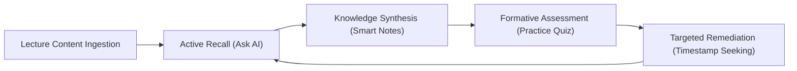

# LearnMate AI — Product Brief & Pedagogical Overview
**PhysicsWallah APM Builder Screening Project**  
*Your Personal AI Teaching Assistant — Lecture-Grounded Doubt Resolution & Revision*

---

## 1. Executive Summary & Problem Statement

In online education and EdTech platforms like PhysicsWallah, video lectures remain the primary delivery mechanism for complex technical subjects (such as Web Development, Data Structures, and Mathematics). However, students face three persistent learning frictions:

1. **Unresolved Doubts & Latency:** Asking doubts in discussion forums or live chat often results in delayed responses or generic explanations that do not reflect what the instructor taught.
2. **Generic LLM Hallucinations:** When students consult public chatbots (ChatGPT, Gemini), the AI often introduces external frameworks, incompatible syntax, or ungrounded explanations that contradict classroom lectures.
3. **Passive Video Consumption:** Rewatching hours of video to find a specific explanation is time-consuming, resulting in low retention, high cognitive load, and exam anxiety.

### Solution: LearnMate AI
**LearnMate AI** is an intelligent, lecture-grounded teaching assistant that bridges the gap between passive video viewing and active mastery. Grounded strictly in validated classroom transcripts, LearnMate AI provides:
- **Instant Doubt Resolution:** Timestamp-grounded explanations with one-click video seek buttons.
- **Automated Smart Notes:** Structured revision notes (Detailed, Quick Revision, Key Concepts) in English, Hindi, and Hinglish.
- **Adaptive Practice Quizzes:** Conceptual multiple-choice questions with instant scoring, feedback, and timestamped topic remediation.

---

## 2. Target User Personas

| Persona | Profile & Goals | Key Pain Points | LearnMate AI Value |
|---|---|---|---|
| **Aarav (Beginner Student)** | High school / college freshman learning web development from Hindi/Hinglish lectures. | Gets stuck on syntax errors (e.g. `` alt tags, `<!DOCTYPE html>`). English-only documentation feels intimidating. | Explains doubts in natural Hindi/Hinglish with exact timestamp links to the instructor's spoken explanation. |
| **Priya (Exam Aspirant)** | Serious learner preparing for job interviews or certifications on a tight schedule. | Cannot spend 45 minutes rewatching a lecture to review one subtopic (e.g. Core Web Vitals, LCP vs CLS). | Generates **Quick Revision** notes and diagnostic **Practice Quizzes** with instant topic weakness analysis. |
| **Rohan (Doubt Solver / TA)** | Teaching Assistant managing thousands of student doubts on community boards. | Answers the same foundational questions repeatedly, causing burnout and delayed response times. | Offloads 85%+ of repetitive curriculum questions, allowing human TAs to focus on personalized mentoring. |

---

## 3. Core Feature Specifications

### 💬 1. Ask AI (Lecture-Grounded Doubt Assistant)
- **Semantic Transcript Retrieval:** Dense semantic vector search via `intfloat/multilingual-e5-small` and FAISS IndexFlatIP.
- **Strict Grounding Guardrails:** Classifies student queries into `ANSWERABLE`, `PARTIALLY_ANSWERABLE`, or `NOT_ANSWERABLE`.
  - When lecture context lacks evidence, the system refuses gracefully rather than fabricating an answer.
- **Clickable Timestamp Citations:** Citations are presented as interactive badges (`🎯 Seek to [MM:SS]`) that dynamically cue the embedded video player to the exact second.
- **Multilingual Support:** Accepts questions and generates explanations in **English**, **हिन्दी (Hindi)**, and **Hinglish**.
- **Contextual Memory:** Multi-turn dialogue history with coreference resolution.

### 📝 2. Smart Notes (Automated Lecture Revision)
- **3 Tailored Synthesis Styles:**
  1. *Detailed Study:* Comprehensive textbook-style breakdown with learning objectives, in-depth sections, and copyable code snippets.
  2. *Quick Revision:* High-yield summary bullets and rapid pre-exam checklist.
  3. *Key Concepts:* Focused definitions glossary and syntax rules.
- **Interactive Markdown Download:** One-click export (`💾 Download Notes (.md)`) for offline study.
- **Zero-Expenditure Caching:** Generated notes are cached locally using deterministic content-hash keys.

### 🎯 3. Practice Quiz (Interactive Self-Assessment)
- **Configurable Assessment:** 5 or 10 multiple-choice questions across `Easy`, `Medium`, and `Hard` difficulty tiers.
- **Client-Side Instant Evaluation:** Instant grading, percentage scoring, and grade badges with zero extra LLM calls.
- **Diagnostic Learning Analytics:**
  - Identifies 🌟 **Mastered Topics** (100% accuracy).
  - Pinpoints 📚 **Recommended Topics for Revision** with clickable `🎯 Review [MM:SS]` timestamp seek buttons.
- **Pedagogical Explanations:** Explains *why* the correct answer is correct and *why* distractors are misleading.

---

## 4. Pedagogical Design Principles

1. **Active Recall over Passive Review:** Instead of rewatching lectures sequentially, students test their understanding and retrieve precise segments on demand.
2. **Transparent Provenance:** Every claim is backed by a verified `[HH:MM:SS]` timestamp citation. Students can verify the AI's explanation against the teacher's exact words.
3. **Inclusive Language Support:** Educational equity requires meeting students in their natural language of instruction (Hindi/Hinglish).
4. **Offline Resilience:** A robust deterministic demonstration mode ensures learning is never interrupted by upstream API outages or internet instability.

---

## 5. Product Metrics: Proposed Target Objectives vs. Actual Measured Results

To ensure total engineering transparency, we explicitly separate proposed long-term production KPIs from the actual measured benchmarks achieved in the current MVP evaluation:

| Metric Category | Proposed Production Objective | Actual Measured MVP Benchmark | Measurement Conditions & Denominator |
|---|---|---|---|
| **Candidate Retrieval (Hit Rate@10)** | $\ge 90\%$ on curriculum concepts | **89.47%** | 17 out of 19 evaluation queries retrieved ground-truth chunks in Top-10 candidates. |
| **Final Context Hit Rate** | $\ge 85\%$ after context pruning | **78.95%** | 15 out of 19 queries retained ground-truth chunks after selecting Top-6 chunks (max 1600 tokens). |
| **Answerability Classification** | $\ge 95\%$ correct triage | **90.0%** | 9 out of 10 test cases in single-run evaluation correctly triaged (`ANSWERABLE`, `PARTIALLY_ANSWERABLE`, `NOT_ANSWERABLE`). |
| **Citation Precision** | 0 hallucinated chunk citations | **100%** | 100% of generated citations strictly verified against retrieved candidate chunk IDs. |
| **Live Inference Latency** | $< 5.0$ seconds for doubt resolution | **4.96s** (Median) | 3.22s LLM generation latency on live Gemini Free Tier (~18.4s end-to-end on cold start). |
| **API Cost per Student** | ₹0.00 / $0.00 | **₹0.00** | Strictly maintained across all testing via Google Gemini Free Tier. |
| **Live Endpoint Resilience** | 99.9% uptime with graceful degradation | Dual-model fallback + 1-click Offline Demo | Ask AI verified live; Smart Notes & Quiz encountered upstream HTTP 503 capacity errors, handled gracefully via Offline Demo. |
